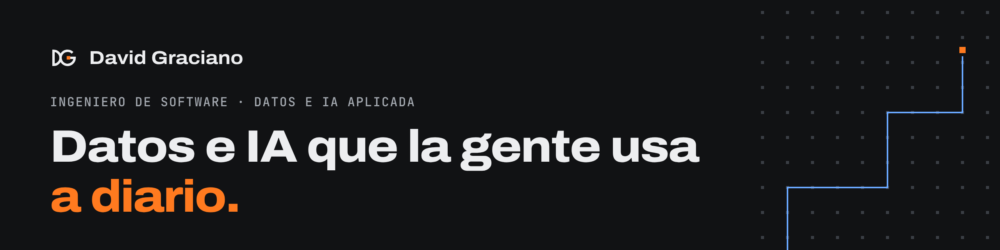

**Ingeniero de Software · Datos e IA aplicada** · Medellín, Colombia

Construyo sistemas de datos e IA que la gente usa a diario. Desde 2024 trabajo con el Centro Integrado de Tráfico y Transporte (CITRA) de la Secretaría de Movilidad de Medellín, donde llevo cada proyecto de punta a punta, y desarrollo backend e IA en Clectif.

### Lo que he construido

- Reindexé **2.624 millones** de registros de cámaras LPR en Elasticsearch y enriquecí el **93,6 %** con datos del registro nacional de vehículos.
- Construí desde cero el **Registro de Siniestralidad Vial**, que reemplazó una hoja de cálculo y hoy se usa a diario, con **133** pruebas automáticas.
- Hice unas **5 veces más rápida** la ingesta y geocodificación de siniestros viales con carga incremental y una cascada de geocodificadores.
- Desarrollo sistemas **RAG** y clientes **MCP** que conectan modelos de lenguaje locales con Elasticsearch, PostgreSQL y Neo4j.

Los casos completos están en mi portafolio. Los datos de CITRA son confidenciales: los repositorios públicos son versiones genéricas, con datos de ejemplo.

### Repositorios públicos

| Repositorio | Qué es |
| --- | --- |
| [appsmith-mcp](https://github.com/Davidgraciano/appsmith-mcp) | Servidor MCP para administrar una instancia propia de Appsmith desde agentes de IA |

### Stack

`Python` `SQL` `PostgreSQL` `PostGIS` `Elasticsearch` `Logstash` `Kibana` `FastAPI` `Docker` `Nomad` `Linux` `RAG` `LangChain` `Ollama` `MCP` `n8n`

### Contacto

[Portafolio](https://davidgraciano.vercel.app) · [LinkedIn](https://www.linkedin.com/in/david-graciano2000/) · davidgracianox@gmail.com

<b>In English</b>

Software engineer in Medellín, Colombia, working on data and applied AI. Since 2024 I have built data systems for Medellín’s Integrated Traffic and Transport Center (CITRA): I reindexed 2.62 billion license plate camera records in Elasticsearch, built a road crash registry used every day, and made crash report ingestion about 5 times faster. I also build RAG systems and MCP clients that connect local language models to company data. Open to remote data engineering, backend and applied AI work.

